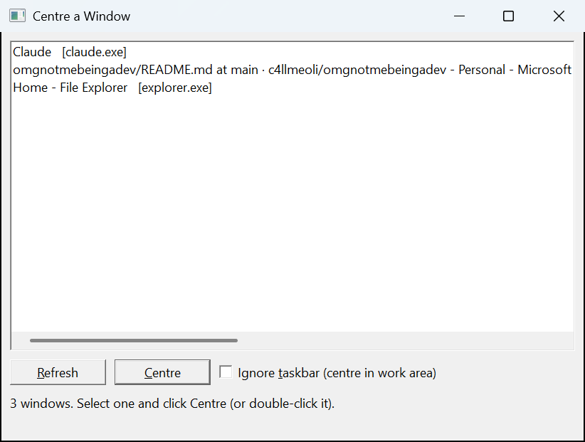

# Centre a Window

Ever accidentally moved a window out of the default position, and you can't seem to get it back in the perfect spot?
This has been the biggest pet peeve of mine of ALL TIME so I made a program for it.

This is an extremely light C program that gets the size of any window you pick, works out exactly where the middle of your screen is, and moves the window there.



## Features

- **Lists every open window** with its title and the program it belongs to (e.g. `Untitled - Notepad [notepad.exe]`)
- **Pixel-perfect centring.** Windows 10/11 put invisible ~7px borders around most windows, which throws off the usual "screen size minus window size, divided by two" maths. This centres the edges you can actually *see*.
- **Works on scaled displays.** 125%, 150%, whatever. It works in real screen pixels, so DPI scaling doesn't knock it off centre.
- **Multi-monitor aware.** The window gets centred on whichever monitor it's already on.
- **Optional taskbar mode.** Tick *Ignore taskbar* to centre the window in the space above the taskbar instead of the full screen.
- **Handles maximised/minimised windows** by restoring them first, then centring.
- **Classic Windows 95-style UI.**

## Usage

1. Download `CenterWindow.exe` from the [Releases](../../releases) page and run it.
2. Pick the window you want from the list.
3. Click **Centre** (or just double-click the window in the list).

Hit **Refresh** if you opened something new after starting the program.

The bar at the bottom tells you what happened, for example:

```
Window 1280x720 on screen 1920x1080 -> moved to (320, 180).
```

### Good to know

- **Odd pixel leftovers:** if the space left over is an odd number of pixels (e.g. a 1001px-wide window on a 1920px screen), it's impossible to be perfectly centred. It'll be 1px off, and the status bar will tell you.
- **Admin windows:** Windows doesn't let normal programs move windows that are running as administrator. If you get an "access denied" message, right-click `CenterWindow.exe` → **Run as administrator**.

## Building from source

You need Visual Studio (or the Build Tools) with the **Desktop development with C++** workload.

Open a **Developer Command Prompt** and run:

```bat
cl /O2 CenterWindow.c /link /SUBSYSTEM:WINDOWS
```

The libraries it needs (`user32`, `gdi32`, `dwmapi`) are linked automatically through `#pragma comment` in the source, so that's the whole build.

## Requirements

Windows 10 (version 1703 or later) or Windows 11.
